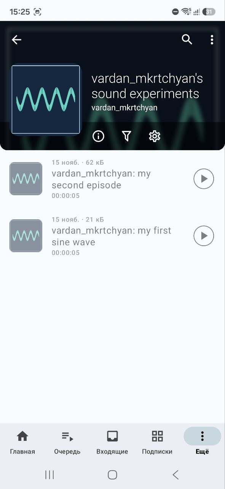

# Answers

My Unix username: vardan_mkrtchyan

Public RSS feed URL: https://the.hell.am/~vardan_mkrtchyan/news.xml

Public podcast feed URL: https://the.hell.am/~vardan_mkrtchyan/podcast.xml

RSS reader and operating system used: Feeder on Android

Podcast player and operating system used: AntennaPod on Android

## RSS

1. Where did you find the first and second `<item>` elements in `news.xml`?

Both `<item>` elements are inside the `<channel>` element, after the channel information (`<title>`, `<link>`, `<description>`, `<language>`). `make_news.py` writes the newest post first, so the second post ("vardan_mkrtchyan: second post, the feed works", GUID `news-item-2`) is the first `<item>`, and my first post ("vardan_mkrtchyan: my first RSS post", GUID `news-item-1`) is the last `<item>` in the channel.

2. What is `<guid>` for? What happens if an old GUID changes?

`<guid>` is a unique identifier for an entry. The feed reader remembers the GUIDs it has already seen, so on every fetch it can tell which items are new and which ones it already has, even if their title or text changes. If the GUID of an old entry changes, the reader thinks it is a brand-new entry: the old post shows up again as a new, unread duplicate (and the old copy may stay in the list as well).

3. What did you observe after refreshing the feed reader?

After I ran `make_news.py` again and pulled to refresh in Feeder, the second post appeared at the top of the list, above the first post. The first post stayed there once and was not duplicated, because its GUID did not change. I did not have to subscribe again or notify anyone: the app just fetched the XML again and noticed the new item.

## Podcast

4. What is the difference between an ordinary RSS item and a podcast RSS item?

An ordinary RSS item only carries text: a title, a description and a GUID. A podcast item has the same elements plus an `<enclosure>`: the URL of the audio file, its size in bytes (`length`) and its media type (`type="audio/mpeg"`). The podcast app reads the RSS to find the episodes and then makes a second HTTP request to the enclosure URL to download or stream the MP3. My podcast items also have a `<pubDate>` and `<itunes:duration>`, but the enclosure is the essential difference.

5. What is the value of `length` in your first `<enclosure>`? What does it measure?

`length="21115"` (in the enclosure of `episode1.mp3`). It is the size of the MP3 file in bytes. It matches the real file: `ls -l ~/public_html/episode1.mp3` shows 21115 bytes, and `curl -I` on the MP3 URL returns `Content-Length: 21115`. The podcast app can use it to know how much it will download before it starts.

6. What changed in the XML after you added the second episode?

A second `<item>` appeared in the `<channel>`, above the first one (newest first). It has its own title ("vardan_mkrtchyan: my second episode"), description ("A 220 Hz square wave, lasting five seconds."), a different GUID (`.../episode-2` instead of `.../episode-1`), its own `<pubDate>`, and a different enclosure URL (`episode2.mp3` instead of `episode1.mp3`) with `length="62455"`. The channel part and the first item stayed the same, including the first GUID, enclosure and length, because `make_podcast.py` does not regenerate an MP3 that already exists.

7. Did you hear both waves in your podcast app? How are the sounds different?

Yes, I played both episodes in AntennaPod and they sound clearly different. The sine wave (440 Hz) is a smooth, pure tone. The square wave sounded a bit higher to me. Its frequency is actually lower (220 Hz, one octave below 440 Hz), but because it jumps abruptly between +1 and -1 it contains many odd harmonics (660, 1100, 1540 Hz, ...), so it sounds buzzy and bright, and a phone speaker reproduces those higher harmonics better than the 220 Hz fundamental. The harmonics are also why its MP3 is bigger (62455 bytes vs 21115) even though both are five seconds long.

## Screenshots

